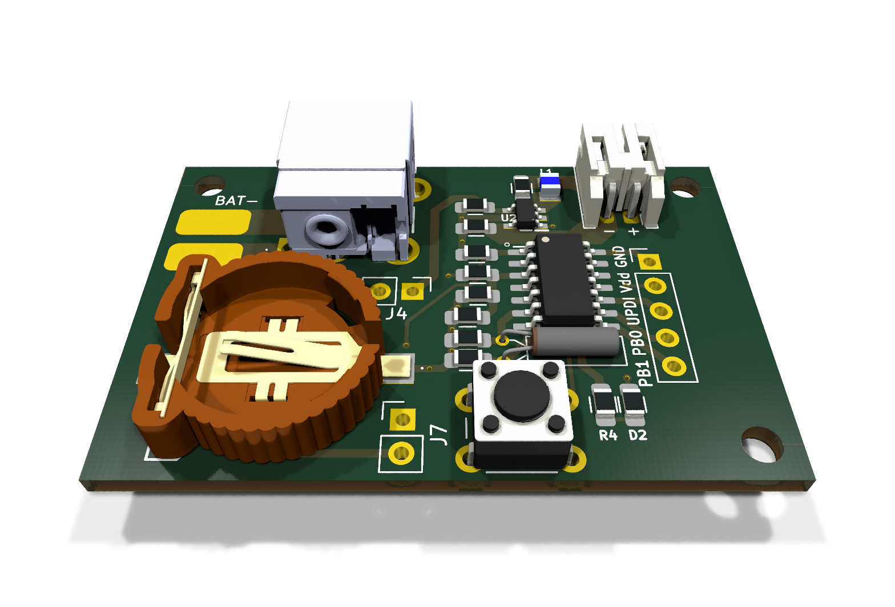
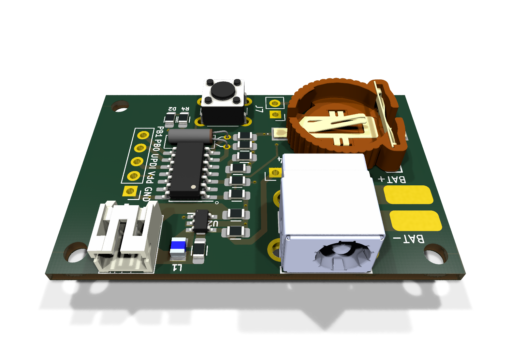
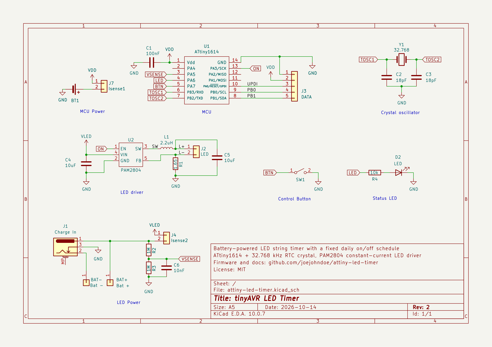
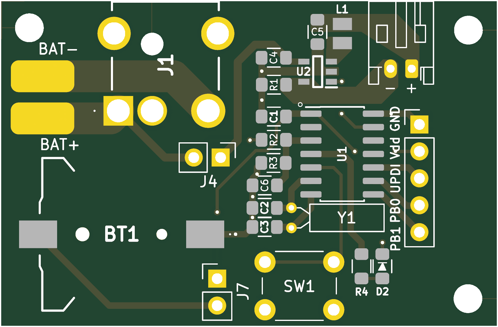

# ATtiny LED Timer

A timer circuit that switches an LED light (like an LED string) on a fixed daily schedule.

A 14-pin Microchip tinyAVR 1 MCU (e.g. ATtiny414) keeps time with a 32.768 kHz watch crystal with < 2s drift per day. It spends most of the time in power-down sleep, resulting in a low 4 µA average current draw for the MCU. A PAM2804 constant-current buck driver powers the LED. The circuit is designed for two separate power rails: a CR1220/CR1225 coin cell for the MCU and an external Li-Ion battery pack for the LEDs, chargeable via a DC power jack. This split allows the MCU to keep the time while the battery pack is charging, without any risk of interference.

Other features:
- **Low-voltage cutoff:** the LED switches off when the battery pack drops below 3.0 V to keep the LED driver stable and prolong battery life. **It is still recommended to use a battery pack with undervoltage protection!**
- **One-button control:** manual override, battery voltage readout and schedule re-sync.
- **Current-measurement jumpers** for the MCU and LED supplies, so you can profile power draw. Insert bridges if you don't need it.
- **Additional GPIO pins** PB0 and PB1 available on the board for auxiliary use.


|  |  |
|-|-|

## Hardware

Schematic and PCB are available in `hardware/attiny-led-timer.kicad_pro` in KiCad 10 format.



### LED Driver

The LED driver is built for LEDs with a forward voltage of 2.7V. The current can be set via sense resistor R1. A resistance of 1.65 Ohms results in a current of roughly 60 mA - see below for instructions on how to compute the resistor value. The LEDs are powered by a power source of 3-6 V wired to the BAT+/- pads. I'm using three 18650 Li-Ion batteries in parallel, which last for roughly 170 h of LED on-time, i.e. about 16 days with the default schedule (10.5 h on per day). The DC power jack connector can be used to charge the batteries (with an appropriate charger). It switches BAT- away from the circuit's GND when connected to isolate the circuit during charging - this means you can't power the LEDs from the DC connector directly (unless you short the ground switch).

#### Computing the sense resistor value

The current flowing through the LED output is determined by the value of the sense resistor, R1. The PAM2804 regulates the voltage across R1 to its feedback voltage of 0.1 V, so:

```
R1 = 0.1 V / I_LED        I_LED = 0.1 V / R1
```
### Controller

The circuit and code works with any of the 14-pin microcontrollers of the Microchip tinyAVR 1 family: from ATtiny214 to ATtiny3214. The code fits into the ATtiny414 and up (about 2.1 KB of flash). It is slightly too big for the 2 KB of the ATtiny214, but can be made to fit, e.g. by replacing `attachInterrupt()` with a direct pin-change ISR.

The MCU is powered by a coin cell so it doesn't lose time even when the main power source is disconnected (e.g. for charging). It is clocked at 1 MHz, so the voltage can go down to 1.8V. The MCU only consumes ~4 uA on average, which means that a CR1220 coin cell can power it for up to a year.

There is a status LED and a button wired to the MCU. Both are entirely optional, not needed for regular use.

### Board and parts

The board measures about 47 × 31 mm and has three M2.5 mounting holes. All resistors and capacitors use a 0805 footprint.




| Ref | Part | Package | Purpose |
|-----|------|---------|---------|
| U1 | ATtiny1614 (or another 14-pin tinyAVR 1-series MCU) | SOIC-14 | Microcontroller |
| Y1 | 32.768 kHz crystal (e.g. ECS-.327-12.5-13X) | Cylindrical, horizontal | RTC time base |
| C2, C3 | 18 pF | 0805 | Crystal load capacitors |
| C1 | 100 nF | 0805 | MCU decoupling |
| BT1 | Keystone 1056 coin cell holder (CR1220/CR1225) | SMD | MCU supply |
| U2 | PAM2804 | TSOT-23-5 | Step-down constant-current LED driver |
| L1 | 2.2 µH (e.g. Samsung CIGT201610EH2R2MNE) | 2016 (2.0 × 1.6 mm) | Buck inductor |
| R1 | 1.65 Ω | 0805 | LED current sense (see [above](#computing-the-sense-resistor-value)) |
| C4 | 10 µF | 0805 | LED driver input capacitor |
| C5 | 10 µF | 0805 | LED driver output capacitor |
| R2, R3 | 1 MΩ | 0805 | Battery voltage divider |
| C6 | 10 nF | 0805 | Voltage divider filter |
| SW1 | 6 mm tactile switch | THT | Control button |
| D2 | LED | 0805 | Status LED |
| R4 | 10 kΩ | 0805 | Status LED resistor |
| J1 | DC barrel jack (PJ-079BH) | THT | Charging input; disconnects BAT− from GND while a plug is inserted |
| BAT+, BAT− | – (solder pads) | – | LED battery pack |
| J2 | JST-PH 2-pin, horizontal (S2B-PH-K) | THT | LED output |
| J3 | 1×5 pin header, 2.54 mm | THT | Programming / data header: GND, VDD, UPDI, PB0, PB1 |
| J7 | 1×2 pin header + jumper | THT | Isense1: MCU supply. Fit a jumper, or connect an ammeter to measure current |
| J4 | 1×2 pin header + jumper | THT | Isense2: LED supply. Fit a jumper, or connect an ammeter to measure current |


## Firmware

The firmware is written as an Arduino sketch in `src/led_timer/led_timer.ino`. You can configure the exact on/off times in `kPhaseEnds[]`, and the battery voltage cutoff with  `kLowVoltageThresholdMv` / `kRecoveryVoltageMv` if needed.

### Requirements

- [Arduino IDE](https://www.arduino.cc/en/software)
- [megaTinyCore](https://github.com/SpenceKonde/megaTinyCore) board package
- A UPDI programmer (see below)

### Building and flashing

The MCU is flashed via UPDI. I'm using Adafruit's UPDI Friend, but there are cheaper solutions like [SerialUPDI](https://github.com/SpenceKonde/AVR-Guidance/blob/master/UPDI/jtag2updi.md). Note that there's no resistor between the UPDI connector and the MCU on this board, as I found it to be unnecessary with the UPDI Friend.

Configure the following settings in Arduino IDE:
1. Select **Tools → Board → megaTinyCore → ATtiny3224/1624/1614/1604/824/814/804/424/414/404/214/204**
2. Set **Tools → Chip** to **ATtiny1614**.
3. Set **Tools → Clock** to **1 MHz internal**.
4. Set **Tools → Programmer** according to the programmer you're using (**SerialUPDI - SLOW: 57600 baud** for the UPDI Friend) and select the right port for **Tools → Port**.


### Usage

| Action | Effect | Feedback (status LED) |
|--------|--------|-----------------------|
| Power up | Starts the clock at 8 PM | 3 blinks |
| **Short press** | Toggles the override: inverts the LED state until the next phase change | 2 blinks = LED now on, 1 blink = LED now off |
| **Double press** | Measures the LED battery pack and blinks out its voltage | See below |
| **Long press** (2 s) | Resets the clock to 8 PM and clears the override | 3 blinks |

Voltage readout: the voltage is blinked as three digits, with a 1 s pause before each one.
For example, 3.75 V is shown as 3 blinks, 7 blinks, then 5 blinks. A zero is shown as 10 quick blinks. Use this to verify that the battery voltage readout is still correct after making changes to the voltage sense circuitry.

To sync the MCU's time with the real time, long-press the button at 8 PM.

### How it works

At startup, the input buffers on every pin are disabled to avoid leakage from floating inputs. The button
pin is then re-enabled with a pull-up and a wake-up interrupt. The RTC's periodic interrupt timer (PIT) fires once per
second from the crystal and increments a seconds counter. Each time the MCU wakes up, it:

1. handles a button press, if there is one,
2. samples the LED battery pack voltage (the ADC is only enabled for a few hundred µs),
3. works out the current schedule phase and drives the LED driver's enable pin,
4. goes back to power-down sleep.

## License

Released under the [MIT License](LICENSE). This covers everything in this repository: the firmware in `src/`,
the KiCad design files in `hardware/` and the images in `docs/`.
